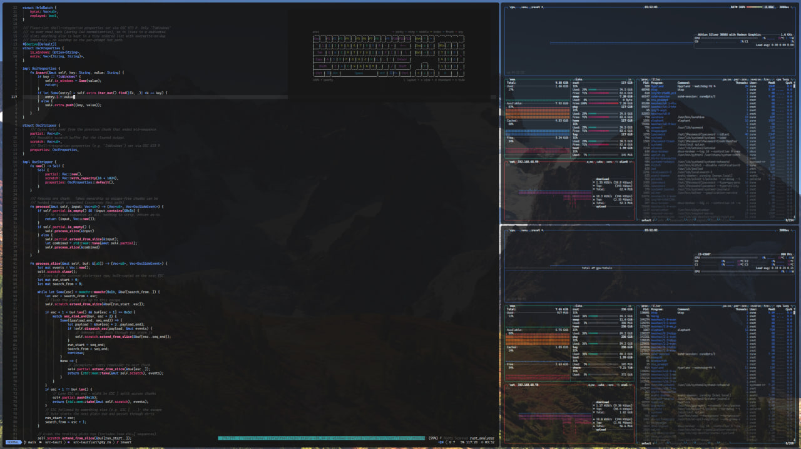

# Partty

<p align="center">
  
</p>

A fast, fun, QoL-focused terminal workspace for Windows.

Optimized for speed and minimizing latency, Partty achieves near-native input-to-render latency metrics,
as well as frame rates up to ~70% of Windows Terminal, in a WebView2 sandbox otherwise notorious for
being slow (how???).

Partty also includes a plethora of quality-of-life (QoL) features.

## Features

What does Partty give you?
Take a look:

https://github.com/user-attachments/assets/50b6efde-94e8-49dc-b8a8-38c7b454d877

### Tabs and Panes

- Fast, organic pane splits. Move panes anywhere, resize them however you want. Set them to float.
- Set a floating pane to follow, so it sticks when you move across tabs (good for watching logs,
  but switching contexts at the same time).
- Send a pane to a different tab. Pop a floating pane (set to follow) into any tab, not just its origin tab.
- Open new panes with specific profiles -- shells, ssh profiles, WSL distributions.
- Tabs, with full control; tab groups (with group colors), per-tab colors.
- Hide the tab bar via the command palette or keybind; a terminal with no distractions.
- Panes inherit the working directory of the terminal they split from, so you don't have to constantly Set-Location
  or cd to the directory you were in. They also inherit the profile/shell; if you're working with WSL, or SSH,
  a new pane split from that terminal inherits the same profile.

### Profiles 

- Custom profiling system that automatically scans for WSL distributions, local shells, git-bash;
- Make your own profiles (including SSH), ignore them so they don't show up in the list, or make a command profile;
- Inject a startup command to a pre-configured profile, so you can start a coding agent in WSL or send btop to an SSH
  connection automatically without doing so every time (treat it as a split).

#### SSH

- Optional shell integrations can be sourced to your shell profile on remote devices, which enables notifications
  and other features for SSH connections. Without it, SSH profiles are still entirely functional, just without
  much of the fancy things.

### Window

- Summon and hide the window -- set the hide operation to destroy the webview, shave memory use
  to low native numbers and pop it back in immediately, returning to your workspace.
- Move your window across monitors _faster_ with a custom keybind.
- Window backdrop: opaque, CSS-transparent, or native acrylic blur with a tunable tint.

### Customization

- Most, if not all, of the options that xterm.js supports in customization, Partty supports.
- Change the UI font, change the terminal font, and more.
- On top of this, Partty supports customizing almost every keybind in the application, as well as behaviors
  for split styles, borders, focus opacities, blurs, and more.
- Hide your cursor and take advantage of the first-class keyboard-only experience.
- Toggle notifications on, off.
- Shape terminal padding, pane padding, window padding, corner radii or set terminals to square. Use the whole
  screen, or don't. Make it look how you want it to look.

### Notifications

- Be notified when a process ends _anywhere_ and navigate to the terminal where it ended using the notification block.
- See what pane it's in and what process ended.

### Animation, Motion

- Tweak your animation preferences; use different look'n'feel presets, combinations, or turn them off.

### Command Palette

- Find shortcuts and run app actions from the command palette. Type `:` to
  browse or search tabs and their panes, see running commands or idle panes, and
  jump to a result. Programs that emit terminal progress also show a ring in
  the palette and on their tab.

### Theming

- Theme your application with opt-in [preset files](resources/themes/), fork a preset or build your own.
- Set the theme of a specific pane to differentiate it, while keeping the rest of the app with the global theme.

- Create complex theme presets using their `.toml` config files to set different cascading preferences for different
  themes; set font sizes, gaps, animation presets, and more, for one theme, and change them for another. These override
  the main `config.toml` when explicitly defined.

### Manual configuration, designed for versioning

- Configure everything how you want, store in a repository, move it where you need to and jump back in. Classic
  dotfiles style (stored under `~/.partty`).

## Performance

Against Windows Terminal, we achieve ~70% FPS on `DOOM-Fire-zig` (DFZ; an updated benchmark running
on Zig 0.16.0, counting rendered frames). This translates to about 190FPS vs a native 285FPS on WT.

Against VSCode's integrated terminal (an existing, battle-tested implementation of xterm.js),
we beat the DFZ benchmark metrics by about 3-5x.

## Installation

Download the binary from the releases page. From here, you can either add it to PATH or start the binary directly.
To run, you will need to have the WebView2 runtime installed (which it likely is for newer Windows Builds).

Windows Defender may flag and remove the binary during runtime, so at the moment you'll need to exempt it by
explicitly white-listing its process name and/or white-listing its path.

## Development

To run the dev build, clone the repository; then run:

```shell
> pnpm install
> pnpm run build
> pnpm run tauri dev
```

This starts the dev build. You can override the window show/hide keybind in dev builds during runtime,
which is explicitly introduced to help develop the application while using a release build of Partty simultaneously.

To build the release binary, you can run:

```shell
> pnpm run tauri build
```

This will build and produce the partty.exe binary under `./src-tauri/target/release/`, alongside specific installer bundles.

To test, you can do a few different things depending on what you're working on:

Changes that relate to the front-end:

```shell
> pnpm test:front
```

For changes that relate to the back-end:

```shell
> pnpm test:rust
```

For changes that span across both the back and front-end:

```shell
> pnpm test
```

For the full sweep, including the vendored PTY patch crates and the production build:

```shell
> pnpm test:all
```

Static checks:

```shell
> pnpm typecheck
> pnpm lint
```

## Roadmap

Recently, a lot of the features that I *thought* were unique and differentiated this implementation from others
were readily apparent in terminals like Rex (great work by Superlogical and Mitchell by the way, 
and other (though questionably maintained) open source terminals. Clearly, in the age of AI, it's increasingly 
easy to face competition (for which I can't blame anyone; plus, I definitely use it).

So the goal is to level the playing field; the project might move away from Tauri, try becoming class-platform,
and improve things like TtFP, rendering speed, parsing, and so on. A big change, sure, but it's needed.

Some of the things I find to be notable features we're missing is fast, performant SSH (low typing latency, lightning
fast rendering of terminal state), faster overall performance (it's incredible what I've got to work inside of the webview,
but I can't act like it's native performance), and things like visual copy mode, etc.

A lot of features have been tried and removed; alert strings (managing strings to match in terminals or specific profiles
so you can be notified, for example, when "stopped" is emitted in the terminal buffer for a deployment host SSH profile); a
ACP based command line helper (reads the buffer context and provides help on something you ask about), and persistent terminal
history.

Of these, most of them are problems already solved (see Atuin, which solves the last two), but I may return to alert strings
at some point, since it's an interesting feature and unlocks some real world value when working in the terminal, and not
just larping with six Claude panes.

Some of the more obvious priorities will be things like OSC 7501 for agent/program status, which will be followed by
expansion of the naive interpreter to consume this and notify directly on the desktop when the front-end is hidden.

With this being said, six or seven months of work have gone into almost pure performance and friction work; day to day,
this terminal is more than performant enough (dare I say competitive with the others for actual use) and splits, switches, tabs,
floating panes, and the rest are very easy to get a hang of and use, as are profiles. But there's a lot to do, and before that, 
a lot to *think* about, so the roadmap is essentially a work in progress as much as the terminal is. You may see some features or
experience improvements come up, but they won't be major (they might).

## Note on Image Rendering

If you use the terminal on it's own, you won't be able to render images. This isn't a fault of the terminal itself,
but rather that the OS PTY provider will actually remove unrecognized sequences from the stream.

The solution is the same as Windows Terminal; load `OpenConsole.exe` and `conpty.dll` alongside the terminal,
and use them instead of conPTY. This enables Sixel rendering.

I may look into making OpenConsole and conpty.dll embedded within the binary, but this offers a scoped feature for 
non-negotiable size increase.
